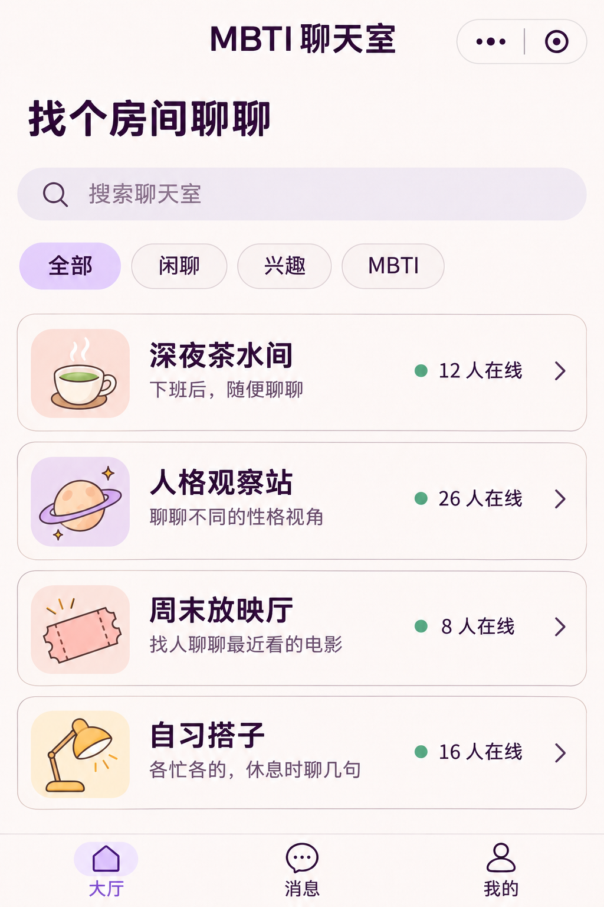

# MBTIChat · MBTI 聊天室

一个以 MBTI 和兴趣为主题的微信小程序聊天室。前端使用原生微信小程序，后端使用 Node.js、MySQL 8.4 和 Redis，通过 WebSocket 推送聊天消息。

- **首次登录**：直选 16 种人格类型，或完成 24 题非正式测验。答案留在客户端，只有确认后的类型会保存。
- **发现与聊天**：按分类浏览或搜索房间，收发文字和图片，查看历史记录和未读消息，收藏房间。
- **个人设置**：编辑资料、隐藏 MBTI、管理黑名单和提交反馈。通知开关只保存偏好，尚未接入微信订阅消息。



## 本地快速开始

需要 Git、运行中的 Docker Desktop（含 Docker Compose）和[微信开发者工具](https://developers.weixin.qq.com/miniprogram/dev/devtools/download.html)。

```bash
git clone https://github.com/CarlLinGitHub/MBTIChat.git
cd MBTIChat
docker compose up -d --build --wait
```

1. 打开 <http://127.0.0.1:8080/healthz>，确认 API 可访问。MySQL 和 Redis 不映射到宿主机。
2. 在微信开发者工具导入**仓库根目录**，不要直接导入 `miniprogram/`。根目录的 `project.config.json` 已指定源码目录，并默认使用游客 AppID。
3. 在模拟器勾选本地使用说明，点击「使用本地演示账号」。选「新用户」体验首次设置，或选栗子、小林、阿舟直接进入大厅。
4. 在大厅搜索「茶」，打开「深夜茶水间」试发消息。要验证实时收发，可用两个独立导入的项目副本分别登录不同演示账号。

默认 API 地址只适用于**同一台电脑上的模拟器**。手机上的 `127.0.0.1` 指向手机本身，不能用它访问电脑上的服务。如果服务未就绪，执行 `docker compose logs --tail=100 api db redis` 查看日志。

运行 `docker compose down` 停服务并保留数据。建表和演示数据只在空 MySQL 数据卷上初始化；`docker compose down -v` **会删除本地数据库和媒体数据**。

## 项目结构

| 路径 | 用途 |
| --- | --- |
| [`miniprogram/`](miniprogram/) | 小程序页面、组件、API 和实时连接 |
| [`backend/`](backend/) | HTTP API、登录、房间、媒体和 WebSocket |
| [`db/`](db/) | 建表脚本 `01-schema.sql`、演示数据 `02-demo.sql` |
| [`draft/`](draft/) | 界面设计稿与[数据库设计](draft/database-design.html) |
| [`compose.yaml`](compose.yaml) | 本地 API、MySQL 和 Redis |

## 参与协作

- GitHub 仓库公开。贡献者可以 fork 后提交 PR；约定见[开发与代码规范](CONTRIBUTING.md)。
- GitHub 访问权限和微信小程序权限相互独立。仅在本地使用游客 AppID 不需要加入正式小程序；如需使用团队的正式 AppID，请让管理员在微信公众平台添加你的微信号为项目成员并授予开发权限。
- 不要提交真实 AppSecret、访问令牌、用户数据或本机的 `project.private.config.json`。

## 部署

仓库中的 Compose **仅用于本地开发**：包含公开的演示凭据、明文 HTTP/WS 和审核旁路，不要直接部署到公网。正式部署应关闭后端 `LOCAL_DEMO` 和前端 `miniprogram/lib/api.js` 的 `localDemo`，在服务端配置 `WX_APP_ID`、`WX_APP_SECRET` 和独立会话密钥，并配置 HTTPS/WSS 合法域名、内容审核、私有媒体存储及数据保留期限。

## 许可证

本项目采用 [MIT 许可证](LICENSE)。
